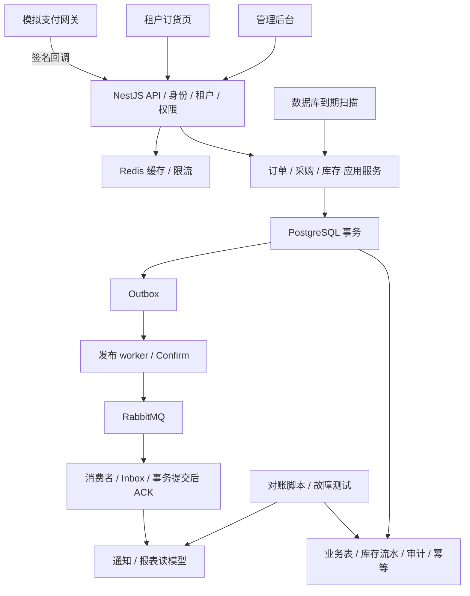

# TradeFlow SaaS：企业业务管理与订单库存交易平台

制定日期：2026-10-23。周期：8 周 / 56 天。配套：[每日执行清单](./TradeFlow-SaaS-56天每日计划.md) · [面试与 AI 协作手册](./TradeFlow-SaaS-面试与AI协作手册.md)。

## 1. 项目定位

**面向中小贸易企业的多租户业务平台，打通客户、采购、库存、电商订单、模拟支付、发货和经营报表。**

建议仓库名 `tradeflow-saas`，独立项目目录 `H:\codex\项目\tradeflow-saas`。本次仅生成计划，不创建应用或远程仓库。

你的优势是已有 Python / 后端基础；本项目用于补齐 TypeScript / Node.js / NestJS 体系，并用交易业务展示数据库、并发和可靠性能力。目标岗位是初中级 Node.js 后端、TypeScript 全栈中的后端方向、SaaS 业务开发。高级岗位要求的真实生产规模、带团队、长期运维经验不能由个人项目替代。

**核心主张：不仅能管理业务，还能提供证据说明重复请求、并发争抢和消息重投后账仍然对。**

计划覆盖这些岗位常见的主要技术能力，不声称经过统计覆盖“绝大多数市场岗位”。Java/Go 专岗、云基础设施专家、数据库内核与前端专项要求需要另补。

## 2. 招聘参考与学习深度

截至查阅日期，可读的 [Ruzora Node.js/NestJS 后端招聘页](https://www.ruzora.com/jobs/nodejs-backend-engineer)强调事件循环、SQL 与迁移、真实数据库集成测试、队列重试幂等、观测与容器，并提到多租户。这是资深岗位样本，仅用于提取技能方向。

[Grid 的招聘页](https://jobs.ashbyhq.com/gridverify/b9760884-8aac-4f76-9922-0ce8c048bb63/)搜索索引列出 NestJS、PostgreSQL、RabbitMQ、Redis、关系模型和故障容忍；该页直接读取依赖 JavaScript，作为辅助参考。样本偏国际市场，不代表国内招聘占比。第 56 天再用与你城市、经验、语言条件匹配的 10–15 条实际 JD 做投递校准。

学习深度分三层：

- **必须能独立解释与修改**：订单状态、库存约束、事务、权限、请求幂等、Outbox/Inbox、消费者 ACK。
- **必须做出可运行实现**：Prisma 迁移、Redis 缓存、RabbitMQ、Jest 集成测试、CI、Docker、报表与基本页面。
- **理解并做小实验即可**：Serializable 对照、RLS、分布式锁局限、读模型重建、100 倍流量演进。不要在两个月内实现全部扩展。

## 3. 时间预算与范围

按每周 6 天开发、每天 3.5–4 小时，另一天约 1 小时复盘，共约 176–200 小时，另留 10–20 小时机动。AI 辅助脚手架、界面与测试样例，复杂事务和并发调试仍需自己理解。

若 JavaScript / TypeScript 几乎零基础，第一周不足以完全熟悉生态：可以先补 5–7 天再启动 56 天计划，或整体延长至 10–12 周。每天只有 1–2 小时也应延长；不通过删掉正确性测试来赶工。

### 必做范围

| 领域 | 两个月内实现 | 明确边界 |
|---|---|---|
| 租户与权限 | 企业、成员、租户切换、角色权限、资源归属 | 预设角色；不做完整组织树和自定义权限平台 |
| 商品与库存 | SKU、仓库维度、现存/预占/可用、流水与对账 | 每订单单仓；不做调拨、批次、序列号与成本核算 |
| 客户 | 客户资料、联系人、订单历史 | 不做销售线索自动化、营销和复杂 CRM |
| 供应商与采购 | 供应商、采购单、提交审批、一次性全量收货 | 不做部分收货、供应商结算与采购退货 |
| 销售订单 | 后台代客下单、简化电商下单、价格快照、状态流转 | 单币种、整单发货；无优惠券、税务、拆单 |
| 模拟交易 | 支付尝试、签名回调、重复去重、超时取消、晚到款补偿 | 无真实资金；晚到款模拟退款，其他退款/售后选做 |
| 审计 | 业务动作、操作者、时间、变更摘要、关联请求 | 应用层追加写；不声称防篡改合规审计 |
| 报表 | 每日订单/实收金额、采购金额、低库存、客户排行 | 经营口径；不冒充会计报表或利润核算 |
| 交付 | 管理端、简化订货页、API 文档、容器、CI、部署、录像 | 页面使用现成组件，重点投入后端 |

### 选做与裁剪顺序

选做：CSV 导入、实际邮件、部分退货、库存调整审批、RLS、OpenTelemetry 全链路、多仓调拨、Kubernetes。主线延迟时依次裁掉装饰性 UI、导入、独立监控平台、RLS、多仓功能。保留权限、库存约束、幂等、Outbox/Inbox、真实数据库测试和在线演示。

## 4. 业务融合：管理端与电商共用交易核心

示例企业是办公用品经销商，租户 A、B 各有自己的商品、客户、供应商、仓库和人员。租户拥有自己的订货页，客户账号只能访问所属企业且授权给该客户的资源。

完整演示路径：

1. 采购员建立 10 件键盘的采购单，管理员审核。
2. 仓管收货一次，库存由 0 变成 10，产生库存流水与审计。
3. 后台业务员与电商客户端都通过同一 `submitOrder` 应用服务下单。
4. 下单原子预占库存；库存不足时整单失败，不留下半张订单或部分占用。
5. 模拟网关回调支付成功，订单转为已支付，库存继续预占。
6. 仓管发货，现存与预占同时减少，库存流水记录出库。
7. RabbitMQ 消费业务事件，生成站内通知和报表读模型；对账核对源表与投影。

另一条重要路径：未支付订单到期，后台扫描任务取消并释放库存；之后到达的支付成功通知进入补偿任务，模拟退款成功后关闭异常，不复活订单或再次占库存。

必须演示：两家租户隔离、100 次请求争抢 10 件库存、同一幂等键重复下单、重复支付回调、消费者提交后未 ACK 被重投、RabbitMQ 暂停后恢复。

## 5. 技术架构与分工

**NestJS + TypeScript + PostgreSQL + Prisma + Redis + RabbitMQ + Jest + Docker** 为后端与交付主栈。按你的要求，前端统一使用 **Vue 3 + TypeScript + Vite + Vue Router + Pinia + Element Plus**，采用 Composition API 与 `<script setup>`。

管理后台与客户订货页共用一个 Vue 工程，通过路由布局分区；Pinia 管理当前会话、已授权租户、权限展示与购物车草稿，不缓存数据库权威库存。请求层使用 Axios 封装错误、凭据、请求 ID 和幂等键；表格分页/筛选走服务端。表单用 Element Plus，图表用 ECharts。后端以 Jest + HTTP 集成测试为主；前端仅对关键逻辑使用 Vitest + Vue Test Utils，浏览器核心流程使用 Playwright，避免强行把 Vue/Vite 测试装进后端 Jest 配置。

前端训练包括路由守卫、权限菜单、组合式函数、组件复用、会话恢复、接口类型、分页筛选、表单验证、重复提交与错误处理。前端权限仅决定展示，后端仍独立核验身份与资源归属。时间投入控制在总工时约 20%–25%，优先完成交易与管理流程。

采用模块化单体：一个 NestJS API、一套共享领域模块、一个独立 worker 进程。核心交易在同一 PostgreSQL 数据库事务内完成，避免学习项目过早拆分交易微服务。

| 组件 | 负责什么 | 不依赖它保证什么 |
|---|---|---|
| PostgreSQL | 业务真相、事务、约束、库存、幂等、Outbox/Inbox | 不用消息队列代替核心库存事务 |
| Prisma | 数据模型、类型访问、迁移、事务客户端 | 不能因为用了 ORM 就省掉 SQL 与并发分析 |
| Redis | 商品/报表短期缓存、限流、可选会话缓存 | 不将 Redis 锁或库存缓存作为防超卖的唯一依据 |
| RabbitMQ | 通知与报表事件传输、重试/死信示例 | 不假设只投递一次，也不承担原子下单事务 |
| NestJS | 模块、依赖注入、输入校验、认证授权、异常映射 | Controller 不直接拼接跨模块交易逻辑 |
| Jest | 单元、真实数据库集成、回归和并发验证 | mock 测试不作为真实锁与事务正确性的证据 |
| Docker Compose | 开发依赖、双 API 实例实验、部署复现 | 单机容器演示不等于高可用集群 |

所有服务版本在 Day 1 核实兼容并锁定，避免 `latest`。Prisma API 会随大版本变化，事务、原始 SQL、迁移命令按锁定版本的官方文档实现，本计划不强行套用旧教程 API 名称。



## 6. 必须先定义的业务不变量

这些是设计约束和未来验收目标，不是已经通过的测试结果。

### 库存口径

`available = on_hand - reserved`，全部使用整数件数，满足 `on_hand >= 0`、`reserved >= 0`、`reserved <= on_hand`，并用数据库 CHECK 约束兜底。

| 业务动作 | on_hand | reserved | available |
|---|---:|---:|---:|
| 采购收货 q 件 | +q | 不变 | +q |
| 创建待付款订单 q 件 | 不变 | +q | -q |
| 支付成功 | 不变 | 不变 | 不变 |
| 待付款取消或到期 | 不变 | -q | +q |
| 已支付订单发货 | -q | -q | 不变 |

支付成功仍保留预占，发货才真正出库，避免把“售出”“预占”“物理库存”混在一起。起始库存也通过入库流水建立，不能直接 seed 一个无法对账的余额。

每笔库存变动与对应余额更新、业务状态、审计、Outbox 在同一数据库事务内提交。流水记录 `delta_on_hand`、`delta_reserved`、业务关联与唯一动作 ID。重复输入 SKU 先合并，统一按仓库/SKU 排序操作库存行；任一 SKU 不足就回滚整单。

### 订单与支付状态

订单：`PENDING_PAYMENT → PAID → SHIPPED → COMPLETED`；`PENDING_PAYMENT → CANCELLED`。MVP 不支持已付款用户取消、部分发货或售后退货。

订单状态与支付记录分开：成功交易、晚到款待退款、退款完成等属于支付/补偿状态。重复事件不得让已发货订单退回已支付。

支付、主动取消、超时取消均先锁同一订单行或使用等价条件状态更新，再执行后续动作。明确截止时间规则：以取得订单锁后的数据库时间判定是否到期；即使超时扫描尚未运行，过期后的回调也不允许转 PAID。不要相信客户端时钟或未经校验的网关时间来决定库存归属。

实现时注意 PostgreSQL 的 `CURRENT_TIMESTAMP` / `now()` 固定在事务开始时间；本计划的规则需要在取得锁后读取实际数据库时钟（例如 `clock_timestamp()`），避免锁等待跨过截止时间却仍采用旧时间。过期回调发现订单仍是 PENDING_PAYMENT 时，在当前事务中完成取消、一次性释放预占与创建补偿待办；若已取消则只登记尚未处理的支付事实和补偿，不重复释放。

金额使用单币种整数最小单位，例如 CNY 分，数据库可用 BIGINT；在 TypeScript 中使用 bigint 或明确范围验证，JSON 边界输出十进制字符串。订单价格、商品名称与单位在下单时保存快照，由服务端重算总额，不接受客户端总价作为权威。

### 幂等与权限

- 请求幂等键作用域：租户 + 调用主体 + 操作类型 + key；保存规范化请求摘要、结果与业务资源 ID。同 key 同内容返回原结果，不同内容返回冲突；超时结果未知时查询已提交结果。
- 数据库唯一约束处理并发争抢；“先查没有，再创建”本身不构成幂等。核心请求记录与业务写入同事务。订单还可保留客户来源订单号唯一键，说明幂等记录过期后的保证边界。
- 支付事件去重和交易去重分开：provider/merchant/event ID 防重投；provider/merchant/transaction ID 防止不同事件重复确认同一笔交易。金额、币种、商户归属、订单映射与签名都需验证；同 ID 不同内容标为冲突。
- 租户上下文来自已验证会话与成员关系。请求可选择租户，但服务端必须验证权限；tenant ID 不能仅由任意请求体提供。
- 客户订货账号额外受 customer 归属限制，不能只做到租户内互相可见。
- 核心关系采用 `(tenant_id, id)` 组合唯一约束与组合外键，防止订单引用另一企业客户、SKU 或仓库。角色权限不能代替资源归属检查。

## 7. 数据模型与工程结构

分期建表，不先制造完整 ERP 模型：

| 领域 | 建议实体 |
|---|---|
| 身份 | users、tenants、memberships、roles/permissions 或预设权限映射、sessions |
| 基础资料 | customers、suppliers、products、skus、warehouses |
| 库存 | inventory_balances、reservations、inventory_movements |
| 采购 | purchase_orders、purchase_order_lines、goods_receipts |
| 订单 | sales_orders、sales_order_lines、shipments |
| 交易 | payment_attempts、payment_events、refund_jobs、idempotency_records |
| 工程 | audit_logs、outbox_events、consumer_inbox、notifications、daily_metrics、export_jobs |

`reservations` 保留每订单每 SKU 的占用状态，支持按订单释放和发货核销。金额快照不可用商品当前价格反算。历史业务对象用停用标记或受限删除；不允许删除已被交易引用的 SKU、客户和供应商造成历史断裂。

```text
tradeflow-saas/
  apps/api/                  # NestJS HTTP 应用
  apps/worker/               # Outbox 发布、消息消费、到期扫描
  apps/web/                  # 管理端与简化订货页
  packages/domain/           # 状态、不变量、金额与领域规则
  packages/database/         # Prisma 模型、迁移、事务实现
  packages/contracts/        # API 与事件 schema
  tests/integration/         # 真实 PostgreSQL/Redis/RabbitMQ
  tests/concurrency/         # 多连接、多进程与竞争测试
  tests/e2e/                 # HTTP 与少量浏览器流程
  scripts/                   # seed、demo、reconcile、benchmark
  docs/planning/             # 三份计划
  docs/adr/                  # 架构取舍
  docs/devlog/               # 每周工作记录
  reports/                   # 实际结果与原始数据索引
  infra/                     # Compose、反向代理、部署
  .github/workflows/
  README.md
```

使用 workspace 即可，不要求引入 Nx/Turborepo；同一个模块化单体也可以把领域模块先放在 API 内，再共享给 worker。结构以读得懂为准。

## 8. 交易和消息可靠性设计

### 防超卖的基线实现

事务内对库存执行带条件的原子更新，示意 SQL 如下；实际代码必须参数化，并验证 q 为正整数：

```sql
UPDATE inventory_balances
SET reserved = reserved + $1
WHERE tenant_id = $2
  AND warehouse_id = $3
  AND sku_id = $4
  AND on_hand - reserved >= $1
RETURNING on_hand, reserved;
```

没有更新到行即表示资源缺失或库存不足，整个订单事务失败。订单、订单行、预占记录、流水、幂等结果与 Outbox 必须使用同一个事务客户端。事务中不调用 RabbitMQ、支付网关或发送邮件。

这是本项目单行库存判定的起点，多 SKU、状态迁移和重复回调仍需完整事务设计。Read Committed 下竞争更新会等待并重新检查更新后的行条件，参见 [PostgreSQL 隔离级别](https://www.postgresql.org/docs/current/transaction-iso.html)。统一加锁顺序并对死锁/序列化失败做有界重试，参见 [PostgreSQL 显式锁](https://www.postgresql.org/docs/current/explicit-locking.html)。不要把“加事务”理解为自动消除所有竞争。

Prisma 无法清楚表达的条件更新或锁操作，可以使用所锁定版本支持的参数化 SQL，并保证处于同一事务。参见 [Prisma 事务文档](https://www.prisma.io/docs/orm/fundamentals/transactions)。

### Outbox / Inbox

1. 业务事务里插入 Outbox：event ID、tenant、aggregate ID、aggregate version、事件类型、schema version、最小必要快照。
2. 发布 worker 领取待发事件，使用短事务设置 claim/lease，不持有业务事务等待网络。
3. 使用 publisher confirms；处理连接断开、confirm 超时、nack 和不可路由消息。只有确认成功且未发生路由失败才标记已发送。
4. Confirm 成功但更新 Outbox 前进程崩溃会再次发布；这是预期的重复窗口。
5. 消费者在数据库事务中插入唯一 Inbox 记录 `(consumer_name, event_id)`，更新站内通知/报表，然后提交。
6. 提交后再 ACK。提交后 ACK 前崩溃会重投，Inbox 与业务状态检查阻止重复副作用。
7. 使用有限重试与死信。MVP 可用“确认发布到重试队列后再 ACK 原消息”；该过程可能重复，不能丢掉发布确认检查。选择 DLX/quorum 策略时记录其可靠性配置，不把默认配置等同于无损转移。
8. 事件乱序不能回退业务状态。报表对固定业务事实做幂等增量；需要顺序的状态投影检测 aggregate version 缺口，延后处理或从源表重建。

Publisher confirm 表示 broker 接收情况，不表示消费者已完成；消费者 ACK 也不能代替数据库提交。两者的边界见 [RabbitMQ 官方说明](https://www.rabbitmq.com/docs/confirms)。单节点持久化队列与数据卷只能覆盖计划中的进程重启演练，不代表磁盘故障下的高可用。

### Redis 使用边界

缓存用于商品目录、报表等允许短暂旧数据的查询；下单始终读取数据库权威价格和库存。key 包含租户、权限作用域与查询条件；TTL 和失效策略写清楚。版本化 key 或提交后失效均应测试并发旧值回填风险。

Redis 故障时，普通缓存读取可回源并限制负载；认证、限流按接口风险定义失效策略，不能无条件绕过权限。Redis 分布式锁作为选做实验讨论过期、续租和 fencing，不承担库存的唯一正确性保证。

## 9. 用证据证明“重复与并发仍正确”

所有实验使用合成数据；最终数字必须实测。并发测试使用真实 PostgreSQL、多连接，关键场景通过两个 API 进程分发请求，不能只用 mock 或单连接顺序执行。

| ID | 场景 | 预期不变量与证据 |
|---|---|---|
| C01 | 初始库存 10，100 个不同订单请求各买 1 件 | 正常依赖下最终 10 个成功、90 个库存不足；reserved=10，available=0；非业务错误单列，不能冒充库存不足 |
| C02 | 同一幂等键、相同参数并发请求 30 次 | 同一个订单 ID，仅一组预占/流水；若返回处理中，最终重试收敛到原结果 |
| C03 | 同 key 不同商品或数量 | 明确冲突，不改变原业务数据 |
| C04 | A 足够、B 不足的多商品订单 | 整单失败；A 没有残留预占，订单与 Outbox 无半成品 |
| C05 | 相同支付事件重投，以及不同事件引用同一交易 | 只发生一次支付确认，不重复计入报表；参数冲突被记录 |
| C06 | 支付回调与到期取消竞争 | 要么截止前 PAID 保留预占，要么 CANCELLED 释放且晚到款进入补偿；不能支付成功又无库存占用 |
| C07 | 多实例重复取消 / 重复发货 | 释放或出库只执行一次，库存始终合法 |
| C08 | 收货请求重复或并发重试 | 全量收货只增加一次库存，采购状态与流水一致 |
| C09 | DB 已提交、响应丢失或 API 进程退出 | 同 key 重试找回原结果，不产生第二订单 |
| C10 | MQ 停止，业务事务继续提交 | Outbox 积压可见；恢复后投影/通知补齐，原业务未丢失 |
| C11 | 发布确认后未记账、消费提交后未 ACK 时退出 | 可发生重投，但通知、投影不重复；能够通过事件 ID 追踪 |
| C12 | 临时错误、毒消息、乱序与死信重放 | 有限重试、死信原因可查；修复后重放不重复业务效果 |
| C13 | 跨租户 ID、跨客户 ID、报表导出与缓存命中 | 不泄露资源，不允许越权动作，拒绝路径留安全记录 |
| C14 | 随机执行下单/支付/取消/发货/收货序列 | 每轮检查库存、预占、流水和订单状态；记录 seed 可复现 |
| C15 | Redis 不可用 | 正确性不受缓存影响；按照文档中的降级/拒绝策略运行 |
| C16 | 报表重建与持续交易 | 基于明确截止点/一致快照核对；避免边读边变造成假差异 |

建议每个并发场景重复至少 20 轮，使用可控 barrier 与故障点放大竞争窗口，记录实际执行次数。测试通过是对这些场景的经验验证，不是对所有可能调度的形式化证明。

报告至少包含：Git SHA、依赖版本、机器 CPU/内存、进程与连接池数、初始数据、请求数与并发数、成功/业务拒绝/系统异常分类、p50/p95、最终状态与核对 SQL、失败日志和复现 seed。

对账脚本检查：

- 余额 on_hand = 从零起所有已提交流水 delta_on_hand 之和。
- 余额 reserved = 流水 delta_reserved 之和 = 当前有效 reservations 数量之和。
- 已取消订单无有效 reservation；已发货订单没有未核销预占。
- 每个逻辑收货/发货/支付事实只产生一次业务效果。
- 报表达到截止点后与同口径源表汇总一致。

在同一个只读一致快照中执行多表校验，或让测试环境暂停写入后核对；不能拿不同时间的查询结果宣称账不平。

## 10. 8 周交付节奏

| 周 | 主线 | 周末可演示内容 |
|---|---|---|
| 1 | TypeScript/NestJS、身份、租户、权限、CI、页面壳 | A/B 租户隔离、角色动作差异 |
| 2 | SKU、库存流水、客户/供应商、采购审批与收货 | 采购入库，重复收货只入一次 |
| 3 | 订单、原子预占、幂等、模拟支付、取消、发货 | 交易闭环与抢库存脚本 |
| 4 | RabbitMQ、Outbox/Inbox、重试、补偿、到期扫描 | 重投不重复、消息恢复、晚到款闭环 |
| 5 | 完整业务界面、客户订货、报表、导出与审计 | 采购到交易到报表完整展示 |
| 6 | 真实并发、故障注入、随机序列、对账 | C01–C16 的主要结果与失败修复 |
| 7 | SQL/索引、Redis、性能、双实例、部署与恢复 | 性能报告、缓存降级、可访问候选版 |
| 8 | 独立复验、README、录屏、简历、面试 | v1.0.0 + 演示 + 正确性报告 |

日常建议 2–4 个有效提交，每周复盘日 1 个也合理；预计约 90–150 个是参考而非 KPI。Issue → 小改动 → 验证 → 自审 PR → 合并，每周打一个实际里程碑 tag。不要伪造提交日期和进度。

## 11. GitHub 与部署交付标准

README 首屏有：一句话价值、演示入口、GIF、核心证据链接。后续提供角色账号/访客说明、架构图、状态图、快速启动、测试命令、迁移方式、已知限制与数据声明。

建议最终脚本契约：`pnpm dev`、`pnpm test:unit`、`pnpm test:integration`、`pnpm test:concurrency`、`pnpm demo:race`、`pnpm reconcile`、`pnpm bench`。这是待实现的入口约定，不能现在就声称可运行。提供跨平台脚本或清楚说明 WSL2/Docker Desktop 前提。

部署为单机 Docker Compose，包含反向代理、web、api、worker、PostgreSQL、Redis、RabbitMQ；按实测选择资源，不预先承诺低配主机可承担压测。公开 Demo 每访客隔离，使用合成数据和受限操作额度；RabbitMQ 管理页、数据库端口、故障注入入口不公开。

并发演示默认在本地或专用测试环境运行。公开站点仅提供有界的小规模演示或明确标注的录屏/预录报告，不允许访客任意压测。支付网关与退款均是模拟器，页面必须标识。

运行成本只涉及选择的主机/域名等；AI 编程订阅另计，本项目本身不需要模型 API。先设个人预算上限，再按实际供应商报价决定托管；没有预算也可交付本地一键演示与录像，但在线 Demo 应明确尚未提供。

备份与回滚必须演练：数据库备份恢复到隔离库并核对数据；镜像回滚与数据库迁移兼容分开处理，优先 expand/contract 思路，不能盲目回退破坏性迁移。

## 12. 最终完成条件

- [ ] 陌生人按 README 可以初始化并运行完整合成业务。
- [ ] 两租户、员工角色、客户归属和报表导出均有隔离验证。
- [ ] 采购入库、下单、模拟支付、发货、报表有真实数据库状态变化。
- [ ] C01–C16 的适用场景有结果、证据、失败分类与限制；未完成明确标记。
- [ ] 有库存/预占/流水对账命令，明确报表延迟与口径。
- [ ] 使用真实 PostgreSQL/RabbitMQ 的集成测试进入 CI，故障和长压测独立执行。
- [ ] 有 5–8 份 ADR、至少 3 篇带实验数据的复盘、持续真实提交。
- [ ] 可以独立解释事务边界和消息重投，并现场修复一个缺陷。
- [ ] GitHub、演示或本地替代路径、视频、报告与版本发布说明完整。

建议把这个项目与之前的 SupportOps Agent 先后完成，各安排约两个月。若每天总共只有 3–4 小时，不应把两个项目都塞进同一个两月周期。后续可以给本平台增加只读 Agent 助手，主线期间先把交易正确性做好。

## 13. 官方技术参考

- [NestJS 授权](https://docs.nestjs.com/security/authorization)：学习框架授权入口，业务层仍核对资源归属。
- [NestJS 测试](https://docs.nestjs.com/fundamentals/testing)：测试模块与应用验证。
- [PostgreSQL 事务隔离](https://www.postgresql.org/docs/current/transaction-iso.html)、[锁](https://www.postgresql.org/docs/current/explicit-locking.html)：理解实际数据库竞争行为。
- [Prisma 事务](https://www.prisma.io/docs/orm/fundamentals/transactions)：以选定版本 API 实现事务，不混用教程版本。
- [RabbitMQ Confirms / ACK](https://www.rabbitmq.com/docs/confirms)：明确消息确认的两端边界。
- [Vue 3 快速开始](https://vuejs.org/guide/quick-start)、[Vue Router](https://router.vuejs.org/)、[Pinia](https://pinia.vuejs.org/introduction.html)、[Element Plus](https://element-plus.org/en-US/guide/quickstart.html)：前端脚手架、路由、状态与组件按锁定版本实现。

这些来源支持技术机制；项目规模、日程和验收目标是本计划的设计建议，不是已经取得的结果。
